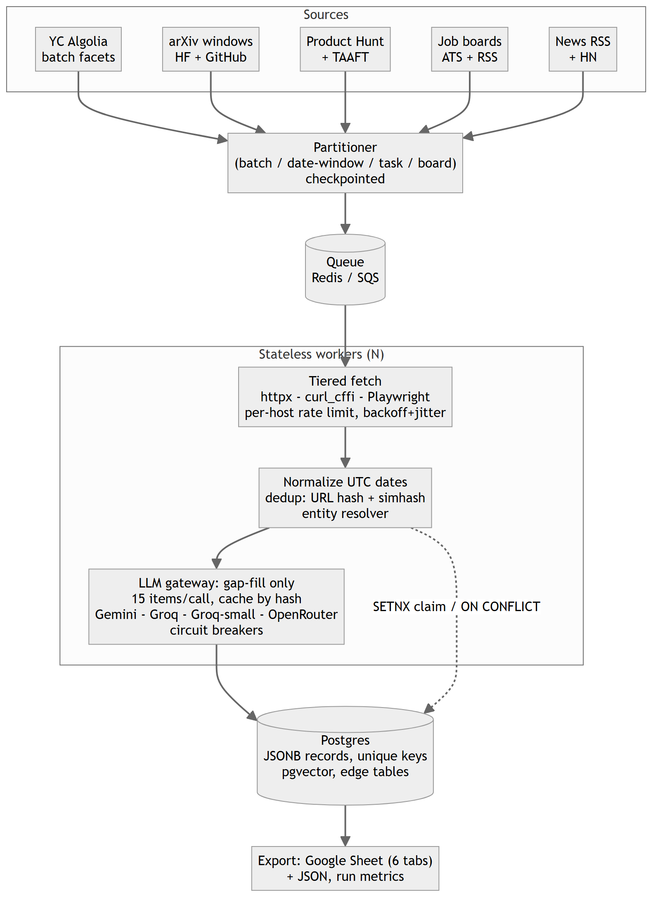

# Architecture: scaling the ingestion pipeline to 500k records

The pipeline is a set of **stateless async workers** around a **checkpointed partitioner**, a **queue** and a
**single source of truth** (SQLite today, Postgres in production; the store sits behind one `Database` interface and
`DB_URL`). Structured API fields are used deterministically; the LLM only fills gaps (pricing, role family, remote
flag, news summary/entities).

## 1. Scale strategy to 500k

| Measured today (1 process, 1 laptop) | Result |
|---|---|
| YC directory | 6,406 startups in ~25 s (about 250 records/s), 2,897 flagged AI |
| arXiv + GitHub | 1,303 papers with repos in ~40 s; 871 stars from 10 GraphQL calls (100 repos/query) |
| Products | 1,885 stored from 2 sources (Product Hunt, TAAFT) |
| Jobs / news | 114 jobs and 152 articles inside the strict 24 h window |

At 250 records/s, 500k API-style records is ~35 minutes on one process; the real bottleneck is not CPU but
**per-host politeness and LLM quota**, so the design scales by adding hosts' worth of parallelism, not by going faster
on one host:

* **Partitioned crawls.** Every source is split into independent, idempotent units: YC by `batch` facet (works around
  Algolia's 1,000-hit cap), arXiv by 7-day windows, Product Hunt by cursor, TAAFT by task page, jobs by board, news
  by feed. A partition is the unit of retry and checkpoint.
* **Queue + stateless workers.** Partitions are pushed to Redis (or SQS); any number of workers pull, crawl and
  upsert. Workers hold no state, so scaling is `N` containers and a crash only re-queues one partition.
* **Checkpoints.** Completed partitions are recorded in the DB (`checkpoints` table; resume skips them). Upserts use a
  content hash that excludes `collectedAt`, so re-running a partition is a no-op (`unchanged`) instead of a duplicate.
* **Postgres.** Unique `(record_type, dedup_key)` makes concurrent writers safe; batch `INSERT ... ON CONFLICT`
  replaces the SQLite upsert with no crawler changes.
* **Per-host rate limits.** A token-bucket per host (e.g. arXiv 0.33 req/s) is enforced in each worker and divided by
  worker count (or kept in Redis for a global limit). Fetching escalates httpx -> curl_cffi -> Playwright only on
  blocks, so the expensive browser tier is the exception (news run: 234 requests, 43 blocks, 26 escalations).

## 2. 413 and 429 strategy (LLM gateway)

* **413 / oversize:** estimate tokens before the call (3.5 chars/token), strip boilerplate, compress to key
  sentences, then split on sentence boundaries and merge the JSON results. If a provider still returns 413, halve the
  budget and retry (`llm.413_avoided` counts pre-emptive fixes).
* **Fewer, fuller calls:** 15 items per request (products, site pricing, news backfill): about 80 calls instead of
  1,206 for the product catalogue.
* **429:** honour `Retry-After`; otherwise full-jitter exponential backoff (`sleep = rand(0, base*2^n)`) so workers
  do not retry in lockstep. A `Retry-After` over 60 s, or a quota/billing 429 / 402, is not waited out: the provider
  is *held open* in its **circuit breaker** (1 h for exhausted quota) and traffic moves on immediately.
* **4-tier chain, free first:** Gemini -> Groq `gpt-oss-120b` -> Groq `gpt-oss-20b` -> OpenRouter. Each tier has its
  own breaker (closed / open / half-open probe). Malformed JSON counts as a provider failure and falls back. Verified
  live: a forced bad Gemini key lands on Groq in ~0.7 s; during the run Gemini's daily quota ran out and Groq served
  the 15-item batch with no failed records.
* **Cache by content hash** (DB-backed) means a re-run never pays twice for the same text.

## 3. Freshness and never processing twice across nodes

* **Published-date normalisation:** feed date -> HTML (`<meta>`, JSON-LD, `<time>`, relative text) -> `first_seen`,
  all converted to UTC; the 24 h filter is applied at ingest and again at export. Greenhouse uses `first_published`
  (not `updated_at`, which would let edited old jobs in); sources that delay data by 24 h are documented.
* **Two-level dedup:** (1) canonical-URL hash (tracking params and fragments stripped) catches the same link; (2) a
  64-bit **simhash** over word shingles catches syndicated copies and reposts. Near-duplicate lookup uses four 16-bit
  bands (pigeonhole: Hamming distance <= 3 shares one identical band), so it is an indexed equality lookup, not a scan.
  A re-run of the news vertical dropped 145 repeated URLs and 1 syndicated copy out of 223 fetched.
* **Distributed:** the claim must be atomic. Fast path: Redis `SET dedup:{url_hash} <worker> NX EX 86400` (claim before
  heavy work, so two nodes never fetch the same article). Source of truth: Postgres unique constraint on
  `url_hash` with `INSERT ... ON CONFLICT DO NOTHING`; simhash bands live in indexed `integer` columns (or Redis sets
  per band). **Crash safety:** a claim written before its record was persisted is reconciled against stored records at
  the start of each run, so an interrupted worker never makes unprocessed articles look like duplicates (this bug
  bit us once: 168 false `dup_url`).

## 4. Storage

* **Postgres + JSONB as primary.** Schemas are versioned (`schemaVersion 1.0`) and vary by record type and source, so
  the full record is a JSONB payload with a few promoted columns (type, dedup key, content hash, dates). GIN indexes
  serve ad-hoc filters; one transactional store gives constraints, upserts and checkpoints together.
* **pgvector** for semantic search: embeddings of paper abstracts, product descriptions and news summaries live next
  to the rows (HNSW index), enabling "similar startups / papers like this" and fuzzy entity matching without a second
  system. Embedding is a batched, cached worker stage, like the LLM gateway.
* **Graph layer: Postgres edge tables first, Neo4j when needed.** Relationships (startup -- builds --> product,
  paper -- implemented_in --> repo, person -- founded/authored --> startup/paper, news -- mentions --> startup) are
  mostly 1-2 hops, and the entity resolver already yields stable canonical IDs to use as node IDs. An
  `edges(src_id, dst_id, type, source, observed_at)` table with recursive CTEs handles that with no new
  infrastructure. Move to Neo4j only when multi-hop traversals (co-authorship communities, investor paths) dominate
  query load; the edge table is exactly the import format.
